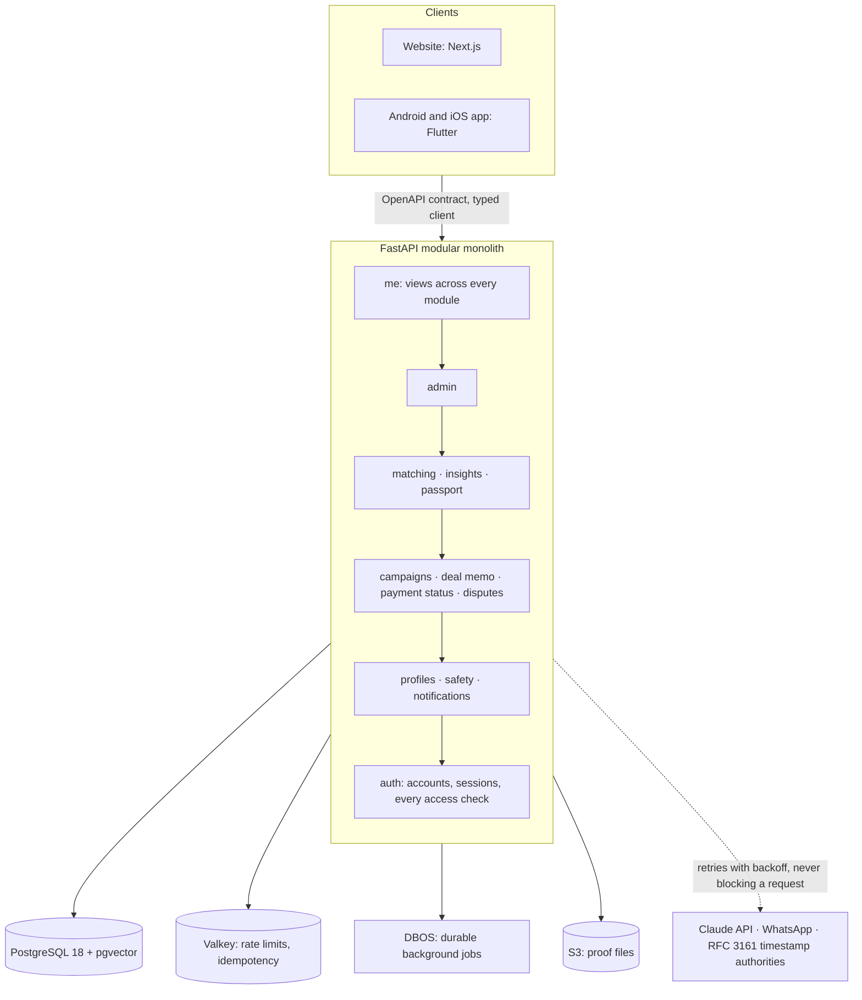

# Colyv

**The trust layer for brand–creator deals in Tamil Nadu.**

[](https://github.com/adhi2801/nicheconnect-tn/actions/workflows/ci.yml)

*Working name in this repository: NicheConnect TN.*

A local café in Madurai wants three food creators for its opening week. Today that deal runs on DMs and trust: a price agreed in chat, a reel that may or may not go up, a payment the creator chases for a month, and nothing either side can point to when it goes wrong. Colyv turns that into a record both sides can rely on: who agreed to what, what was delivered, and whether it was paid. Every step is sealed so that neither side, nor we, can quietly change it later.

**We never touch the money.** Brands pay creators directly, by UPI or bank transfer. Colyv records that it happened. No licence to hold funds, no float, nothing to steal.

---

## What makes it different

| | Typical creator marketplaces | Colyv |
|---|---|---|
| **The agreement** | A chat thread | A deal memo both sides accept, sealed into a **tamper-evident record**: an RFC 6962 Merkle tree (the structure behind Certificate Transparency), anchored by **two independent RFC 3161 timestamp authorities**. Anyone can verify a deal was not edited after the fact |
| **Proof of delivery** | A screenshot sent over WhatsApp | Links and files cleaned of metadata and sealed; **the reach and engagement numbers read off the screenshot by a vision model** |
| **Matching** | A black box, or a giant database to scroll | **Matching both ways with its reasons shown**: shared niches, city, past deals. Semantic search over profiles, never over phone numbers or bank details |
| **Payments** | The platform holds the brand's money, with the licence, fees and risk that brings | **Payment status only**, with a UPI pay link that opens the brand's own app. Each brand's record of paying and each creator's record of delivering, earned from real deals, is shown to the other side before they deal |
| **Pricing** | Guesses | **Fair-rate guidance** from published rate cards: medians shown only when at least five creators back them, with the sample size |
| **Disputes** | Whoever shouts loudest | A neutral timeline of what each side did, built from the record. We record; we do not judge |
| **Local** | Built for Mumbai and Delhi | Tamil Nadu's cities, festivals and seasons. Campaign templates for 16 of them, for every faith and none, dated from the State Government's notified holidays |

---

## AI in the product

Each model does one job, has a measurable output, and a person can always see why it decided.

| System | What it does | Model | How it is held to account |
|---|---|---|---|
| **Matching and semantic search** | Ranks creators for a campaign and campaigns for a creator, with the reasons | `Qwen3-Embedding-0.6B` (1,024 dimensions) in **pgvector** with an HNSW index | Constraint: no personal data ever enters an embedding, only internal IDs and public profile text; reasons computed from facts, never generated |
| **Results read from proof** | Reads views, reach and engagement off a creator's analytics screenshot | Claude (vision), structured output | A labelled test set and a scoring script (`scripts/score_proof_reader.py`); a reading is shown beside the screenshot, never replacing it |
| **Brief drafting** | Turns a few sentences from a brand into a campaign draft | Claude, structured output, refusal-aware | Behind a feature switch, rolled out to a keyed share of accounts; the brand edits before anything is published |
| **Search in plain words** | "food creators in Coimbatore under ₹5,000" becomes filters | Fixed rules, no model | Every word it used and every word it ignored is shown back as a chip the brand can remove |

What comes next for ML is in [`docs/BACKEND_COMPLETE.md`](docs/BACKEND_COMPLETE.md): screening bought audiences from observed reach, and learning to rank from completed deals once the pilot produces them.

---

## Architecture

One deployable FastAPI service, a **modular monolith** with enforced layers: a module may import only from the layers below it, and CI fails otherwise.



**Stack:** Python 3.14 · FastAPI · SQLAlchemy 2 · PostgreSQL 18 + pgvector · Valkey · DBOS · Alembic · OpenTelemetry · Sentry · Docker · AWS (Mumbai), described in OpenTofu. Frontend: Next.js 16 for the website and Flutter for the Android and iOS app, in the same repository. Both build against types generated from the committed API contract.

---

## Engineering, by the numbers

Every number here comes from a tool, not an estimate.

| | |
|---|---|
| **225** API routes | One contract (`docs/api/openapi.json`), committed. Any change to it shows up in review, and the apps' types are regenerated from it in CI |
| **3,683** tests | Run against a real PostgreSQL, never a mock database; **98%** line coverage, and every `service.py` at **90% or more**, enforced in CI |
| **155** property-based tests | Hypothesis checks rules over every input, not just examples: deal stages, payment states, dates, ranking order |
| **Mutation testing** | mutmut, nightly, on every rule where a silent mistake costs money or trust. Survivors are named and driven down |
| **Every rule broken on purpose** | A fix counts only when its test is shown failing without it |
| **Contract fuzzing** | Schemathesis generates requests from the OpenAPI contract in CI; no input may produce a 500 |
| **Latency budgets** | p95 ≤ 300 ms reads and ≤ 500 ms writes on seeded data, measured per route (`docs/PERFORMANCE.md`). Lists make a fixed number of queries, proven by tests |
| **Overload** | A busy server answers 503 with `Retry-After` within a second, and never freezes; measured with a load test |
| **Supply chain** | Exact pins (`uv.lock`), dependency audit, licence check, container image scan, CycloneDX SBOM, secret scanning of the full git history: each a CI gate |

---

## Security and privacy

- **Login without passwords:** a one-time code by WhatsApp; passkeys built and ready for the domain; admins on two factors in one request.
- **Every read and write checks the caller** may see or change that exact object: its owner, a party to the deal, or public by design. Denied by default.
- **Retries are safe:** every write a person can repeat takes an `Idempotency-Key` (IETF draft) and replays its first answer.
- **Errors leak nothing:** one format, RFC 9457 Problem Details.
- **Rate limits on every route**, each documented in the contract and checked by a test that walks every operation.
- **India's DPDP Act:** a full personal-data export, account deletion with a 30-day window, consent recorded per version; no personal data in logs, traces, error reports or embeddings, each proven by tests.
- Verified against **OWASP ASVS 5.0.0**: Level 2 on every route, Level 3 on login, tokens, deletion, payment status and the admin API. Reporting a vulnerability: [`SECURITY.md`](SECURITY.md).

---

## Run it locally

Requires Docker and [uv](https://docs.astral.sh/uv/).

```bash
cp .env.example .env          # fill in local values; never commit .env
docker compose up -d          # PostgreSQL with pgvector, and Valkey
uv sync                       # Python 3.14 and exactly the locked dependencies
uv run alembic upgrade head   # the schema
uv run uvicorn app.main:app --reload
```

`GET http://localhost:8000/healthz` returns `{"status": "ok"}`. The interactive API docs are at `/docs`.

```bash
uv run pytest                                            # the full suite, against your local database
uv run python scripts/seed_dev_data.py --reset           # realistic Tamil Nadu sample data
uv run python scripts/measure_performance.py --explain   # p95 per route, with query plans
uv run python scripts/dev_login.py +919000000001         # an access token for a sample account
```

The scripts refuse to run outside a local environment. Sample phones are `+9190000xxxxx` and emails end in `@example.com`, so no sample row can be mistaken for a real person.

---

## The repository

| Path | What is there |
|---|---|
| `app/` | The API: `core/` (shared), `db/`, and one folder per module under `modules/` |
| `alembic/` | Every schema change, each with a working downgrade |
| `tests/` | Mirrors `app/`, plus the contract, documentation and migration checks |
| `frontend/` | The website, the mobile app, the design tokens and the 3D landing scene |
| `infra/` | AWS in OpenTofu, and the steps to go live |
| `docs/` | Standards, research, the decision log and reports. Start at [`docs/README.md`](docs/README.md) |

**How we work.** Every rule in [`docs/standards/`](docs/standards/) names what enforces it. Every product and architecture decision is recorded with its reasons in [`docs/DECISIONS.md`](docs/DECISIONS.md). The non-negotiables (we never hold money, no personal data in embeddings, every schema change a migration, every public route rate limited, nothing done until tested) are in [`CLAUDE.md`](CLAUDE.md).

---

**Status:** the backend carries the pilot's whole deal flow, from campaign to sealed, paid deal; what is left is tracked item by item in [`docs/BACKEND_COMPLETE.md`](docs/BACKEND_COMPLETE.md). The website and the app are in build. Built in Tamil Nadu by two founders.
